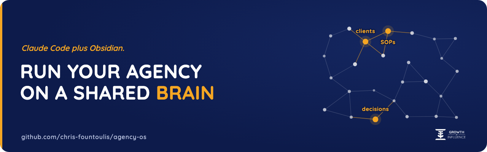
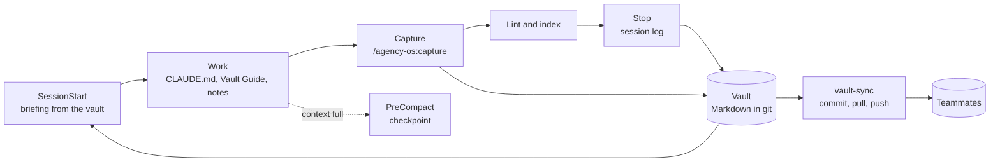

<p align="center">
  
</p>

<p align="center"><b>Run your agency on Claude Code and Obsidian.</b><br>
A shared vault that every Claude Code session reads before it works and writes back to as it goes,<br>
so every session and every teammate starts knowing the company.</p>

<p align="center">
  <a href="https://github.com/chris-fountoulis/agency-os/actions/workflows/ci.yml"></a>
  <a href="LICENSE"></a>
  <a href="https://github.com/chris-fountoulis/agency-os/tags"></a>
  
  
  
</p>

---

## Quickstart (30 seconds)

```bash
git clone https://github.com/chris-fountoulis/agency-os
python3 agency-os/scripts/agency-os init my-agency --name "Acme Agency"
python3 agency-os/scripts/agency-os stats my-agency/vault
```

That gives you `my-agency/vault/` (open it in Obsidian), `my-agency/CLAUDE.md` and
`my-agency/vault-autopilot.md`. Add `--no-examples` for an empty skeleton instead of the
fictional agency. Then, inside Claude Code:

```text
/plugin marketplace add chris-fountoulis/agency-os
/plugin install agency-os@agency-os
```

Start Claude Code in `my-agency/` and the first thing the session sees is the company. Prefer a
command on your PATH? `pip install git+https://github.com/chris-fountoulis/agency-os` and use
`agency-os` everywhere below. Python 3.9+, standard library only.

## Demo

What a session is told at startup (the SessionStart hook, on the bundled example vault):

```text
agency-os: this project's company memory is the Obsidian vault at `template-vault` (35 notes).
Read first: `01 - Company/Vault Guide for Claude Code Sessions.md`.

Open loops: 4 open, 1 overdue (`01 - Company/Open Loops Register.md`).
- OVERDUE Confirm the November ad budget in writing (Sam, due 2026-11-01)
- Send the homepage wireframe for sign-off (Lena, due 2026-11-03)
- Decide whether to restart local SEO in January (Alex, due 2026-12-15)
- Pick the reporting data source for paid social (Jonas, due 2026-11-07)

Recent sessions:
- 2026-10-28 16:05 sam: Added a history line to [[Bluebird Fitness]] and opened a loop in the [[Open Loops Register]], due 2026-11-01, owner Sam.
- 2026-10-27 10:42 jonas: Created [[Monthly Reporting Automation]] from the project template, listed it in the Projects MOC and opened a loop for the data source question.

Vault lint: clean.
```

`agency-os stats template-vault`:

```text
agency-os stats  template-vault  (Northwind Studio)

  Notes              35   Words            4,158
  Links             196   Link density     5.6 per note
  Orphan rate      0.0%   Hub coverage     100.0%
  Open loops          4   Session entries  2 (latest 2026-10-28)

  By folder
    00 - Home            █▋                   1
    01 - Company         ████████████████████ 12
    02 - Clients         ██████▋              4
    03 - Projects        █████                3
    04 - Knowledge Base  ██████████           6
    05 - Meetings        █████                3
    06 - Resources       █████                3
    08 - Sessions        ███▍                 2
    99 - Archive         █▋                   1

  By type
    hub       ████████████████████ 5
    moc       ████████████████████ 5
    resource  ████████████████████ 5
    sop       ████████████████████ 5
    client    ████████████         3
    decision  ████████             2
    meeting   ████████             2
    project   ████████             2
    session   ████████             2
    tracker   ████████             2
    home      ████                 1
    system    ████                 1

  Most linked
    Open Loops Register           ████████████████████ 17
    Management                    ██████████████████▉  16
    Sales                         ██████████▋          9
    Product                       █████████▍           8
    Monthly Reporting Automation  █████████▍           8
```

`agency-os lint` on the example vault, then on a fixture with planted mistakes:

```text
$ agency-os lint template-vault
agency-os lint: 35 notes, 196 links, clean

$ agency-os lint tests/fixtures/broken-vault
02 - Clients/Client A.md
    12  error    broken-link      [[Missing Project]] does not resolve to any note or file

02 - Clients/Client B.md
        warning  moc              not listed in Clients MOC
        error    no-hub           links to none of the hub nodes (Management, Product, Sales, Marketing)
        warning  orphan           no other note links here
     1  error    frontmatter      type 'customer' is not in the vocabulary

02 - Clients/Shared Name.md
        error    duplicate-title  same note name as 04 - Knowledge Base/Shared Name.md (links become ambiguous)
        warning  moc              not listed in Clients MOC

02 - Clients/Untitled.md
        error    generic-name     'Untitled' says nothing about the subject; rename it
     1  error    frontmatter      missing 'status'
     1  error    frontmatter      date '01/10/2026' is not YYYY-MM-DD

04 - Knowledge Base/Empty Procedure.md
        error    empty            note has no content; fill it or move it to the archive
        error    no-hub           links to none of the hub nodes (Management, Product, Sales, Marketing)

04 - Knowledge Base/Loose Thoughts.md
        warning  moc              not listed in Knowledge Base MOC
        warning  orphan           no other note links here
     1  error    frontmatter      no frontmatter block

04 - Knowledge Base/Shared Name.md
        error    duplicate-title  same note name as 02 - Clients/Shared Name.md (links become ambiguous)

agency-os lint: 15 notes, 23 links, 11 errors, 5 warnings
```

## Why this exists

[Growth Of Influence](https://growthofinfluence.com) is a small digital marketing agency in Thessaloniki, Greece.
Most of its work now runs through Claude Code: client deliverables, websites, reporting,
internal tools. The expensive part was never the model. It was context: every new session
started from zero, and every teammate held a different slice of what the company knew.

So the company memory moved into one Obsidian vault that every session reads at start and
writes to as it works. In production it holds about 900 notes across clients, projects, SOPs and
decisions, merged from several team members' vaults into one. Session logs are written
automatically on every turn. A linter keeps the graph honest. Client work can be spun out into
standalone, scrubbed client vaults. A new session knows who the clients are, what was promised,
what is overdue and why each decision was made, before it is asked anything.

Personal second-brain setups are everywhere. Company versions, built for several people and
many sessions sharing one memory with rules about what goes where, barely exist. agency-os is
that system, extracted and generalised: the vault structure, the protocol, the hooks and the
tooling, with a fictional agency (Northwind Studio) in place of the real one.

## Features

- **A vault with a spine.** Numbered folders, a company node above four hubs (Management,
  Product, Sales, Marketing) with a tie-breaker order, a MOC per folder, an open loops register,
  decision records, seven templates, a Home dashboard and Obsidian settings (navy and gold CSS
  snippet, graph colour groups, bookmarks) that look right on first open.
- **Instructions sessions follow.** A `CLAUDE.md` template (identity, hard rules, pointers, and
  "update facts in place, never append") and `vault-autopilot.md`, the capture protocol: what to
  capture, where each kind goes, how to dedup, how to link.
- **A briefing at every session start.** Where the vault is, what to read first, open and overdue
  loops, the latest session summaries and the lint state.
- **Session logs that write themselves.** One structured entry per turn (prompt, files changed,
  summary), credentials redacted, one file per person per day so teammates never conflict.
- **Checkpoints before compaction,** so a long session's history survives the context reset.
- **Lint with real exit codes.** Broken links, orphans, missing hub links, empty and generically
  named notes, frontmatter schema, duplicate names, MOC membership, an optional no-dash rule.
  Text or JSON, `0` / `1` / `2`.
- **A generated index** of every note with a one line summary, deterministic so CI can check it.
- **Client spinouts.** One client's notes and linked knowledge as a standalone vault, every other
  client's name scrubbed, a denylist applied, credentials redacted, then re-scanned: any survivor
  fails the run.
- **Optional git sync** for teams: commit, pull, push every minute, holding back files over 50 MB
  and credential-shaped lines. launchd and systemd templates included.
- **Zero dependencies.** Standard library Python 3.9 to 3.13.

## How it works



Details, the hook contract and the session log format are in
[docs/architecture.md](docs/architecture.md).

## The vault

```text
vault/
├── 00 - Home/            Home dashboard, All Notes Index (generated)
├── 01 - Company/         company node, 4 hubs, Vault Guide, Open Loops Register, Decisions/
├── 02 - Clients/         one note per client + Clients MOC
├── 03 - Projects/        initiatives with an owner and an end + Projects MOC
├── 04 - Knowledge Base/  SOPs and playbooks, grouped by situation + MOC
├── 05 - Meetings/        one note per meeting + MOC
├── 06 - Resources/       tools, glossary, reference + MOC
├── 07 - Templates/       client, project, SOP, decision record, meeting, session log, open loop
├── 08 - Sessions/        written by the hooks, never by hand
├── 99 - Archive/         retired notes; nothing is ever deleted
└── agency-os.json        optional configuration
```

Every note has `tags`, `type`, `status` and `date` frontmatter, an arrow to exactly one hub
(`→ [[Sales]]`) under its title, a one line summary, and a `## Related` section last.

## Commands

| Command | What it does |
|---|---|
| `agency-os init DIR [--name N] [--no-examples] [--hooks]` | Scaffold a vault, `CLAUDE.md` and `vault-autopilot.md` |
| `agency-os lint [VAULT] [--format json] [--strict]` | Integrity checks; exit 1 on errors |
| `agency-os index [VAULT] [--check]` | Regenerate the All Notes Index, or check it is current |
| `agency-os stats [VAULT] [--format json]` | Size, link density, orphan rate, hub coverage, activity |
| `agency-os loops [VAULT] [--overdue] [--owner NAME]` | Open loops from the register |
| `agency-os spinout VAULT --client NAME --out DIR` | Standalone sanitised client vault, with a leak check |
| `agency-os session-log` | Stop hook: append a session log entry from the payload on stdin |
| `agency-os checkpoint` | PreCompact hook: save a checkpoint note |
| `agency-os context [--hook]` | SessionStart hook: print the briefing |

Plugin skills: `/agency-os:capture`, `/agency-os:open-loops`, `/agency-os:vault-health`.

## Configuration

Optional `agency-os.json` at the vault root. Unknown keys are rejected, so a typo cannot quietly
switch a check off.

```json
{
  "name": "Acme Agency",
  "company_hub": "Acme Agency",
  "hubs": ["Management", "Product", "Sales", "Marketing"],
  "forbid_dashes": false,
  "spinout": { "denylist": ["internal margin", "Project Lighthouse"] }
}
```

Every key and its default: [agency_os/config.py](agency_os/config.py). Hooks find the vault by
walking up from the session's folder (a folder with `agency-os.json`, or one level down), or
from `AGENCY_OS_VAULT`. Session logs are named after `git config user.name`, or
`AGENCY_OS_PERSON`.

## More

- [Team setup](docs/team-setup.md): several people sharing one vault through git.
- [Client vaults](docs/client-vaults.md): what a spinout selects, scrubs and verifies.
- [Sync](sync/README.md): the background git sync and its safety rules.
- [FAQ](docs/faq.md)

## Roadmap

- `agency-os lint --fix` for the mechanical findings: MOC membership, missing hub arrows on notes
  with an obvious parent, frontmatter defaults.
- A "since your last session" digest per person, built from the session logs.
- A PyPI release, so `pipx install agency-os` replaces the git URL.
- Hook commands that pick `python3`, `python` or `py` automatically, for Windows without edits.

## Contributing

Issues and pull requests are welcome. Read [CONTRIBUTING.md](CONTRIBUTING.md) first: the test
suite runs with nothing to install (`python3 -m unittest discover -s tests`), and the template
vault must stay lint clean. Security reports go to the address in [SECURITY.md](SECURITY.md).

## License

[MIT](LICENSE)

---

<p align="center">
Built by <a href="https://github.com/chris-fountoulis">Chris Fountoulis</a> at
<a href="https://growthofinfluence.com">Growth Of Influence</a>, where the system it was extracted from runs the company's memory.
</p>
