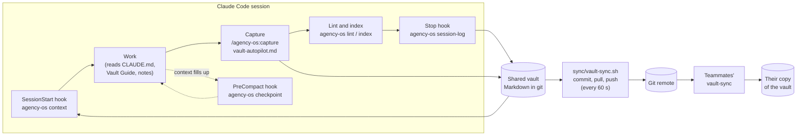

# Architecture

agency-os is three layers around one folder of Markdown:

1. **The vault**: an Obsidian vault with a fixed spine (numbered folders, four hub nodes, MOCs,
   templates) and a written protocol for what goes where.
2. **The instructions**: `CLAUDE.md` (identity, hard rules, pointers) and `vault-autopilot.md`
   (the capture protocol). They tell every Claude Code session to read the vault first and write
   back what it learns.
3. **The machinery**: a stdlib Python CLI and a Claude Code plugin that make reading and writing
   the vault the default instead of a habit: a briefing at session start, a structured log on
   every Stop, a checkpoint before compaction, lint and an index to keep the graph honest, and an
   optional git sync so a whole team shares one memory.

## The loop



Every arrow into the vault is either a person in Obsidian or a session following the capture
protocol. Every arrow out of it is a read: the next session's briefing, a teammate's pull, a
client spinout.

## What each hook does

| Event | Command | Writes | Prints |
|---|---|---|---|
| `SessionStart` | `agency-os context --hook` | nothing | Vault location, the Vault Guide path, open and overdue loops, the three latest session summaries, lint state. Plain stdout on SessionStart is added to the session's context |
| `Stop` | `agency-os session-log` | One entry in `08 - Sessions/<date> Sessions, <person>.md` | nothing |
| `PreCompact` | `agency-os checkpoint` | `08 - Sessions/Checkpoints/<date> <time> Checkpoint, <session>.md` | nothing |

All three read the hook JSON on stdin (`session_id`, `transcript_path`, `cwd`,
`hook_event_name`, plus `last_assistant_message` and `stop_hook_active` on Stop and `trigger` on
PreCompact), find the vault by walking up from `cwd` (a folder holding `agency-os.json`, or a
folder with such a vault one level down), and **always exit 0**. A broken hook must never stop a
session; failures go to stderr.

### Session log entries

```markdown
## 14:05 · session 1a2b3c4d · northwind
%% agency-os 1a2b3c4d 5e0f9a1b2c %%

**Prompt**

> Log the Acme kickoff.

**Files changed**

- vault/05 - Meetings/2026-10-20 Acme Bakery Kickoff.md

**Summary**

> Logged the kickoff in [[2026-10-20 Acme Bakery Kickoff]] and listed it in the [[Meetings MOC]].
```

- The prompt is the last real user turn in the transcript (tool results and meta messages are
  skipped). Files are the `Write`, `Edit`, `MultiEdit` and `NotebookEdit` targets of that turn,
  main thread only.
- Everything passes through `agency_os.redact` first: keyword-anchored values
  (`password: ...`), provider key shapes, JWTs, private key blocks, URL credentials, long opaque
  strings.
- Wikilinks that resolve are kept (so the log shows up in backlinks); the rest become plain text,
  so a log can never break lint.
- The `%% ... %%` line is an Obsidian comment (hidden in reading view) holding the session id and
  a content hash. A Stop event registered twice (plugin plus a settings hook) is written once.
- Subagent stops (`agent_id` set) and continuations forced by another Stop hook
  (`stop_hook_active`) are skipped.

## The vault model

`agency_os.vault` parses only what integrity needs: a flat YAML subset of frontmatter, the H1,
and `[[wikilinks]]` with aliases (`[[Note|text]]`, `[[Note\|text]]` inside tables), headings and
block refs (`[[Note#Part]]`, `[[Note#^id]]`), embeds (`![[file.png]]`) and path-qualified targets
(`[[02 - Clients/Acme Bakery]]`). Links inside fenced code and inline code are ignored, as
Obsidian ignores them. Resolution is case-insensitive by basename, preferring a note in the
linking note's own folder when a name is ambiguous, which is also what lint reports as a
`duplicate-title` error.

## Lint checks

| Check | Severity | Rule |
|---|---|---|
| `broken-link` | error | A wikilink resolves to no note or attachment |
| `no-hub` | error | A note links to none of the hub nodes |
| `frontmatter` | error | Missing block or field, unknown type or status, date not `YYYY-MM-DD` |
| `empty` | error | No content outside headings and rules (the archive is exempt) |
| `generic-name` | error | `Untitled`, `Notes`, `Misc`, `New note 3` and similar |
| `duplicate-title` | error / warning | Same file name twice (ambiguous links) / same H1 twice |
| `orphan` | warning | No other note links here (links from the generated index do not count) |
| `moc` | warning | A note in a MOC folder that its MOC does not list |
| `dash` | warning | Em or en dash in prose, when `forbid_dashes` is on |

Home, Sessions and Archive are exempt from the orphan and hub checks; templates are not linted
at all but links to them resolve. Exit codes: `0` no errors, `1` errors (or any finding with
`--strict`), `2` usage or configuration error.

## Configuration

Everything is optional; `agency-os.json` at the vault root overrides the defaults in
`agency_os/config.py`. Unknown keys are rejected so a typo cannot silently disable a check.

```json
{
  "name": "Acme Agency",
  "company_hub": "Acme Agency",
  "hubs": ["Management", "Product", "Sales", "Marketing"],
  "mocs": { "02 - Clients": "02 - Clients/Clients MOC.md" },
  "forbid_dashes": true,
  "spinout": { "denylist": ["internal margin"], "include_folders": ["03 - Projects", "04 - Knowledge Base"] },
  "session_log": { "max_reply_chars": 1500 }
}
```

`spinout` and `session_log` merge key by key with the defaults; every other key replaces its
default whole (so `"mocs": {}` turns the MOC check off).

## Design choices

- **Standard library only.** The hooks run on every turn of every session on every teammate's
  machine. Nothing to install, nothing to break on a Python upgrade.
- **Plain Markdown, no database.** The vault is the source of truth and stays readable without
  this tool, in Obsidian, on GitHub, or with `grep`.
- **Deterministic generated files.** The index takes its date from the newest note, so an
  unchanged vault regenerates byte for byte and `agency-os index --check` can gate CI.
- **Facts are updated in place.** The protocol and the templates are built around one current
  version of each fact. History lives in git and in session logs, not in stacked corrections.
